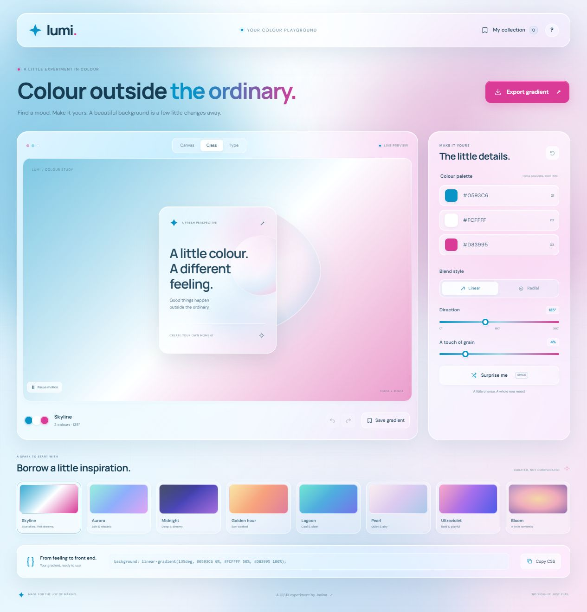

# Lumi — gradient studio

**A little colour. Endless possibilities.**

A glassmorphism playground for creating gradients, trying them in context and exporting a background for your next design.

**[Try the live studio](https://jupiter847.github.io/lumi-gradient-studio/)** · [View the code](https://github.com/jupiter847/lumi-gradient-studio)

Live demo: https://jupiter847.github.io/lumi-gradient-studio/ — no sign-in required.



[Read the design case study](CASE_STUDY.md)

## Try it

1. Start with a curated preset or shuffle a new combination.
2. Adjust three colours, direction, linear/radial style and grain.
3. Explore the Canvas, Glass and Type previews.
4. Save a favourite, copy CSS or export a PNG/SVG in your chosen aspect ratio.

Undo/redo makes experimentation reversible. The motion toggle controls the animated studio atmosphere; reduced-motion preferences are respected. Exports are **static gradient backgrounds**, not animations or screenshots of the interface.

## Design direction

Lumi uses translucent panels, soft ambient colour and a restrained brand palette:

- Cyan `#0593C6`
- Near-white `#FCFFFF`
- Magenta `#D83995`

The [case study](CASE_STUDY.md) separates design hypotheses, implementation checks and research still to be done.

## Run locally

Requires Node.js 20 or later. No dependency installation is needed.

```sh
npm start
```

Open [localhost:4174](http://localhost:4174). Run checks with `npm test`.

## GitHub Pages

This repository keeps its website files at the root. In **Settings → Pages**, select **Deploy from a branch**, then **main** and **/(root)**. After deployment succeeds, use the published URL in the repository’s **About → Website** field and pin the repository on your profile.

## Data and scope

Saved gradients stay in the current browser through `localStorage`; they do not sync between devices. Clearing browser data removes them. The tool has no accounts, backend, analytics or paid API dependency. Google Fonts supplies the typefaces, with system-font fallbacks.

Contrast guidance is a design aid based on selected colours. It does not guarantee readable text at every point of a gradient or translucent surface; evaluate the final composition in its intended context.

## Contribution

Prepared for **Janina Kildisyte’s UI/UX portfolio**. The initial concept, interface design, copy and implementation were assisted by **Codex**. Future research, design refinements and individual contributions should be documented as they are completed.

## Motion and colour

The interface uses sky blue `#0593C6`, icy white `#FCFFFF` and hot pink `#D83995`. Animated ambient colour, a liquid glass sculpture, pointer light, a gentle preview tilt and sparkle trails are decorative. The motion control pauses the effects, and reduced-motion preferences disable them. Image and CSS exports use the static base gradient.
